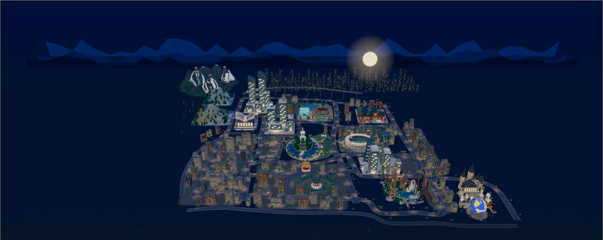

# 北京十二坐标 · 3D 地图

一张可独立运行的北京立体地图：浏览十二个地点，进入北海取景，切换自由视角、冬景与工体灯光。

An independent, self-contained 3D city explorer by **Chen Quan / 陈全**. Twelve destinations, a guided Beihai visit, free camera, seasonal snow and stadium lighting — no API key, CDN or parent application required.



本项目从陈全的地图作品中独立整理，模型使用程序化几何构建。公开版本将 29 处招牌文字替换为许可明确的 Noto 字体轮廓，保留原场景与交互。

## 开始使用

需要 **Node.js 24 或更新版本**，以及支持 ES modules、import maps 和 WebGL 2 的现代浏览器。

不需要父作品集、Next.js、Blender 或 API Key：

```bash
git clone https://github.com/haimuhaimu/beijing-3d-map.git
cd beijing-3d-map
npm ci
npm start
```

打开终端显示的地址，默认 **http://127.0.0.1:3036/**。如端口占用：

```bash
npm start -- --port 3037
```

项目没有 npm 第三方依赖，Three.js 已随目录附带；实际启动只需要 `npm start`。`npm ci` 用于核对锁文件和标准化安装流程。地图运行不需要 CDN、在线地图 API 或网络字体。

**不要双击 index.html 以 file:// 打开**：ES module 与模型请求需要 HTTP。预览服务器仅监听本机，不是面向公网的生产服务器。

## 操作

- 全景：拖动平移、滚轮缩放，点击地标或从地点列表选择。
- 北海：点击“从北海开始”，切换湖岛、白塔、东岸；“返回地图”保留之前的全景位置。
- “自由看”：旋转、平移、缩放与重置视角。
- “季节与设置”：冬景、点亮工体、暂停、减少动态、还原。
- 手机窄屏使用“去一个地方”选择地点；双指缩放/平移的实体设备体验仍需真机验证。
- 无 WebGL 或加载失败时保留静态预览和重试入口。

## 检查与静态导出

```bash
npm test          # 地图/模型回归 + 独立依赖、HTTP、打包测试
npm run check    # 本项目与随包依赖的 JS 语法检查
npm run verify   # 语法检查 → 完整测试 → 静态导出
npm run build    # 生成 dist/
npm start -- --dist --port 3037
```

`dist/` 可以交给普通静态 HTTP 服务预览或部署。它只包含显式清单内的运行/许可文件，以及 `manifest.json`（逐文件 SHA-256 与字节数）；不会复制 tests、scripts、作品集内容或额外放入的文件。
构建发现输出目录中的意外文件会停止并保留它们，不自动删除。

## 目录

```text
index.html / style.css / main.mjs   浏览器入口
*.mjs                              场景、镜头、交互状态与效果
beijing-world.glb                   自包含模型；尺寸见 model-info.json
places.json / model-info.json       地点资料与模型信息
preview.png                        静态回退预览
vendor/                            Three.js 0.180.0 + MIT 许可
scripts/                           本机服务器、白名单导出与语法检查
tests/                             可独立运行的回归测试
docs/VALIDATION.md                  实际验收记录和未验范围
docs/ASSET_AUDIT.md                 素材来源、字体替换与许可核验
dist/                              生成的静态交付，已忽略
```

## 诚实边界

- 包含现有 GLB 的运行交付，不包含完整 Blender 模型重建流水线。
- 地图为艺术化压缩地理，不是导航/测绘产品；崇礼不在北京市内。
- 当前版本没有服务端、账号、在线数据或持久化地图进度。
- 专项逻辑/模型测试不代表手机帧率、旧浏览器或原生容器已通过。
- 这是公开可查看的作品项目，**不是已授予自由复用许可的开源项目**。原创部分保留权利；Three.js 的 MIT 许可和 Noto 字体的 OFL 许可分别保留。详见 [许可](LICENSE) 和 [依赖与素材说明](THIRD_PARTY_NOTICES.md)。
- 地点名称和建筑仅用于地图中的艺术化指认，不代表与景区、品牌或建筑权利人有关联或获得背书；不授予这些第三方标识或设计的权利。
